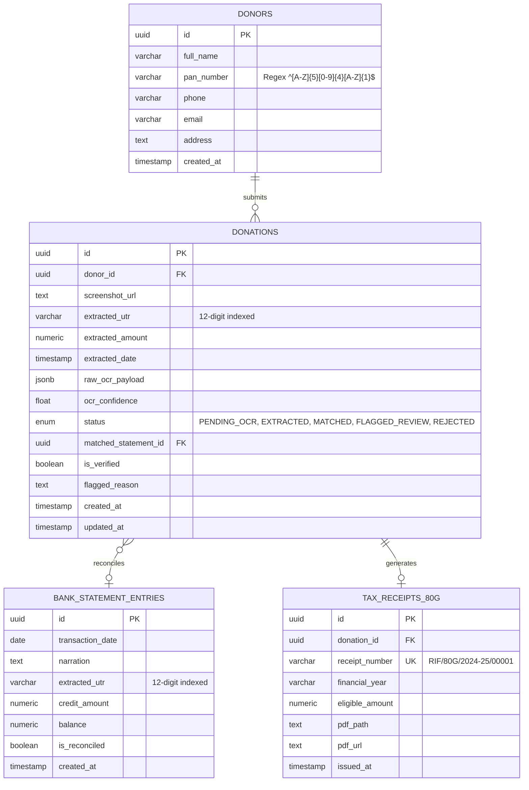

# 🇮🇳 Raise India Foundation: Automated UPI Donation Reconciliation & 80G OCR Portal

A production-grade, full-stack automated donation reconciliation and OCR verification portal developed for **Raise India** NGO.

---

## 🎯 The Core Problem Solved

When donors scan static or dynamic UPI QR codes (via Google Pay, PhonePe, Paytm, BHIM, Cred, etc.), the National Payments Corporation of India (NPCI) UPI protocol does **not** transmit donor identity attributes such as **PAN Number, Full Legal Name, Phone Number, or Address** to the receiving merchant's bank account.

Instead, the NGO receives an anonymous bank statement line:
```
UPI/428910293812/CR/PAYTM/RAJESH VERMA/DONATION  +₹5,000.00
```
Under Section 80G(5)(vi) and Rule 18AB of the Indian Income Tax Act, the NGO **must file Form 10BD** containing the donor's PAN, Name, and Address to issue legitimate 80G tax exemption certificates.

**This portal provides the complete end-to-end solution:**
1. **Public Donor Portal (`/donate`)**: Donors upload payment screenshots and input PAN with live regex validation.
2. **AI OCR Pipeline (`/admin/bulk-upload`)**: OpenCV pre-processes receipts (grayscale, CLAHE contrast enhancement, Otsu thresholding), and regex extracts the **12-digit UTR** and **Amount**.
3. **Auto-Reconciliation Engine (`/admin/bank-statement`)**: Bank statement Excel/CSV files are parsed with Pandas; exact and Levenshtein fuzzy matching link bank credits to donation screenshots.
4. **Side-by-Side Reconciliation Dashboard (`/admin/reconcile`)**: Admin inspects screenshots in a zoomable viewer, corrects misread digits with 1-click live re-matching, and verifies transactions.
5. **Tax Compliance**: Issues digitally signed **Section 80G PDF receipts** via ReportLab and exports compliant **Form 10BD Excel tables**.

---

## 🛠️ Tech Stack Specifications

| Layer | Technologies |
|---|---|
| **Frontend** | Next.js 14+ (App Router), TypeScript, Tailwind CSS, Lucide Icons, Canvas Confetti |
| **Backend** | Python FastAPI (Async), SQLAlchemy 2.0, Pydantic (v1/v2 dual-compatible), ReportLab |
| **Database** | PostgreSQL 16 (UUIDs, JSONB, indexed UTRs) / SQLite development fallback |
| **OCR & Vision** | OpenCV (Grayscale, CLAHE, Otsu Thresholding), Tesseract OCR / Intelligent Fallback Engine |
| **Reconciliation** | Pandas, OpenPyXL, Levenshtein edit distance algorithms |
| **Task Queue** | Celery + Redis (Background async processing with FastAPI fallback) |
| **Containerization** | Docker, Docker Compose (Multi-stage builds) |

---

## 🗄️ Database Schema & Core Data Models



---

## 🚀 Getting Started

### Option 1: Running with Docker Compose (Recommended for Production)

Make sure Docker and Docker Compose are installed:
```bash
# Clone and enter workspace
cd "raise-india-portal"

# Start PostgreSQL, Redis, FastAPI Backend, Celery Worker, and Next.js Frontend
docker compose up --build
```
Once started:
- Frontend Portal: **`http://localhost:3000`**
- Backend API Docs: **`http://localhost:8000/docs`**
- Health Check: **`http://localhost:8000/api/health`**

---

### Option 2: Running Locally (Development Mode)

#### 1. Backend Setup (FastAPI)
```bash
# Enter backend directory and activate Python venv
cd backend
python -m venv venv

# Windows:
.\venv\Scripts\activate
# Linux / macOS:
# source venv/bin/activate

# Install dependencies
pip install -r requirements.txt

# Start FastAPI server (runs on port 8000)
python -m uvicorn backend.app.main:app --host 0.0.0.0 --port 8000 --reload
```

#### 2. Frontend Setup (Next.js)
```bash
# In a new terminal window:
cd frontend

# Install npm packages
npm install

# Start Next.js App Router (runs on port 3000)
npm run dev
```

Visit **`http://localhost:3000`** in your browser.

---

## 🌟 Key Application Pages & Features

### 1. Public Donor Submission Portal (`/donate`)
- **Live PAN Validation**: Automatically enforces uppercase formatting and tests against Income Tax regex `^[A-Z]{5}[0-9]{4}[A-Z]{1}$` with immediate visual feedback.
- **Single File Upload**: Drag-and-drop dropzone for UPI screenshots with real-time image preview and size check.
- **Instant Stepper Acknowledgement**: Shows Tracking ID, OCR-detected 12-digit UTR, and estimated clearance time.
- **Self-Service 80G Certificate Lookup**: Donors can enter their PAN or Tracking ID anytime to check status and download their Section 80G Tax Exemption Certificate PDF.

### 2. Admin Side-by-Side Reconciliation Dashboard (`/admin/reconcile`)
- **Left Pane (Zoomable Image Viewer)**:
  - Interactive Zoom In (+), Zoom Out (-), Reset (100%), and Rotate 90° (↻).
  - Mouse click-and-drag panning across high-resolution payment screenshots.
  - Overlay badges displaying OCR-detected UTR and confidence score.
- **Right Pane (Verification & Edit Console)**:
  - Complete Donor profile card (Name, PAN, Mobile, Email, Address).
  - **Inline Edit & Save**: Correct misread digits (e.g., 0 vs O, 1 vs I) with instant live re-reconciliation against bank statements.
  - **Fuzzy Match Candidates**: Displays ranked bank statement entries based on Levenshtein distance (<= 2) and date window (+/- 2 days) with 1-click `[Link]` button.
  - Action buttons: `[Mark as Verified]`, `[Edit & Save]`, `[Reject / Duplicate]`, and `[Download 80G PDF]`.

### 3. Bulk Screenshot Upload & OCR Pipeline (`/admin/bulk-upload`)
- Multi-file drag-and-drop supporting `.png`, `.jpg`, `.jpeg`, `.webp`, and `.zip` archives.
- Automated ZIP extraction and background OpenCV preprocessing.
- Batch results table with OCR confidence ratings and direct jump links to the split-screen reconciler.

### 4. Bank Statement Ledger & Parser (`/admin/bank-statement`)
- Ingest official bank statement files (`.xlsx`, `.xls`, `.csv`).
- Auto-detects Narration and Credit columns.
- Regex extracts 12-digit UTR from banking formats (`UPI/123456789012/CR/...`, `CMS/...`, etc.).
- Downloadable pre-populated sample bank statement template (`sample_raise_india_bank_statement.xlsx`).

### 5. Form 10BD & Tax Compliance
- Generates official Indian Income Tax Department **Form 10BD Excel reports** containing:
  - Serial Number, Pre-acknowledgement No, ID Type (PAN), ID Number, Donor Name, Address, Donation Type, Mode of Receipt (UPI), Amount, Section 80G.
- Generates legally compliant **80G Exemption Certificates (PDF)** via ReportLab with NGO PAN (`AAATR8291P`), 80G Reg No (`AAATR8291PF20214`), and digital verification stamps.

---

## 📡 REST API Reference

| Method | Endpoint | Description |
|---|---|---|
| `GET` | `/api/health` | Service health status and NGO FY metadata |
| `POST` | `/api/donations/public-submit` | Public donor submission (form-data with screenshot) |
| `POST` | `/api/donations/bulk-upload` | Multi-image / ZIP screenshot upload |
| `GET` | `/api/donations/` | List donations with filters (`status`, `is_verified`, `search`) |
| `GET` | `/api/donations/{id}` | Donation detail with donor, statement, and tax receipt |
| `PATCH` | `/api/donations/{id}` | Inline edit OCR values and live re-reconcile |
| `POST` | `/api/donations/{id}/verify` | Mark verified, reconcile bank entry, issue 80G PDF |
| `POST` | `/api/donations/{id}/reject` | Mark submission as invalid/duplicate |
| `POST` | `/api/bank-statement/upload` | Upload `.xlsx`/`.csv` bank statement |
| `GET` | `/api/bank-statement/entries` | List bank statement credit entries |
| `GET` | `/api/bank-statement/sample-template` | Download sample pre-populated Excel statement |
| `GET` | `/api/reconciliation/stats` | Real-time reconciliation KPI metrics |
| `POST` | `/api/reconciliation/run` | Trigger automated reconciliation engine |
| `GET` | `/api/reconciliation/candidates/{id}` | Ranked fuzzy match suggestions for donation |
| `POST` | `/api/reconciliation/manual-link` | Manually link and verify donation with statement |
| `GET` | `/api/receipts/lookup` | Lookup donations and download receipts by PAN / Tracking ID |
| `GET` | `/api/receipts/download/{filename}` | Download generated 80G PDF certificate |
| `GET` | `/api/receipts/export/form-10bd` | Export compliant Form 10BD Excel table |

---

## 🧪 Testing & Validation

The system includes an automated end-to-end integration test:
```bash
python test_e2e.py
```
This tests:
1. Health and KPI statistics retrieval.
2. Initial seeded queue verification.
3. Levenshtein fuzzy candidate ranking.
4. Donation verification and 80G PDF generation.
5. PAN-based self-service receipt lookup.
6. Form 10BD Excel generation and integrity.
7. Bank statement template download.
